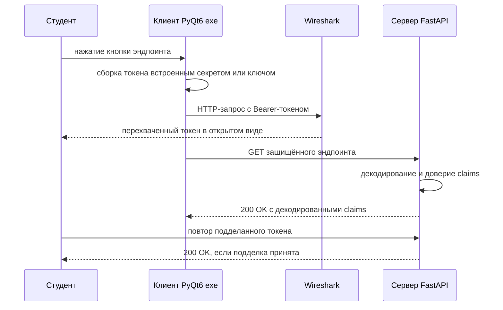

# Учебный API + клиент: план проекта

Цель: собрать намеренно уязвимый учебный API и десктопный клиент на PyQt6, чтобы
студенты могли перехватывать трафик в Wireshark и отрабатывать подделку/взлом JWT.

## 1. Учебные цели

| № | Эндпоинт | Схема токена | Отрабатываемый урок |
|---|----------|--------------|---------------------|
| 1 | `GET /public` | нет | базовый уровень, авторизации нет |
| 2 | `GET /private/none` | JWT `alg=none`, без подписи | убрать/заменить подпись, изменить claims |
| 3 | `GET /private/admin` | JWT `alg=none`, без подписи, `role=admin` | повышение привилегий через подмену claims |
| 4 | `GET /private/signed` | JWT `HS256`, намеренно слабый секрет встроен в exe | восстановить секрет из бинарника, переподписать подделанный токен |
| 5 | `GET /private/encrypted` | JWE `A256GCM`, общий ключ встроен в exe | восстановить ключ, расшифровать, изменить, зашифровать обратно |

Критерий успеха: студент самостоятельно получает валидный токен для эндпоинтов 2–5,
ни разу не получив серверные секреты напрямую.

## 2. Стек

- Сервер: FastAPI + Uvicorn
- JWT/JWS: `PyJWT`; JWE: `jwcrypto` (или `python-jose`); мягкий парсинг для `alg=none`
- Клиент: PyQt6 + `requests`
- Упаковка: PyInstaller, сборка в один файл `exe`
- Публикация: туннель `cloudpub` для публичного URL

## 3. Структура репозитория

```
apiTasks/
├── server/
│   ├── app/
│   │   ├── __init__.py
│   │   ├── main.py            # приложение FastAPI + регистрация роутеров
│   │   ├── config.py          # порты, слабые секреты, ключи, флаги
│   │   ├── security.py        # verify_jwt_none / verify_hs256 / decrypt_jwe
│   │   ├── schemas.py         # модели pydantic для запросов/ответов
│   │   └── routers/
│   │       ├── public.py
│   │       ├── none.py
│   │       ├── admin.py
│   │       ├── signed.py
│   │       └── encrypted.py
│   ├── requirements.txt
│   └── run.py
├── client/
│   ├── main.py                # запуск QApplication
│   ├── api.py                 # обёртка requests, по методу на эндпоинт
│   ├── tokens.py              # сборка токенов alg=none / HS256 / JWE
│   ├── keys.py                # встроенные слабый секрет + ключ JWE (утечка)
│   ├── ui/main_window.py      # кнопки, панели запроса/ответа, лог
│   ├── client.spec            # spec-файл PyInstaller
│   └── requirements.txt
├── docs/
│   ├── student_handout.md     # описание задания для студентов
│   ├── instructor_guide.md    # запуск, ход занятия, подводные камни
│   └── solutions.md           # разобранные ответы по эндпоинтам
├── scripts/
│   ├── run_server.bat
│   ├── build_client.bat
│   └── cloudpub.md
├── tests/
│   └── test_endpoints.py
├── plans/plan.md
└── TODO.md
```

## 4. Проектирование бэкенда

### Форматы токенов

- `/private/none` и `/private/admin`: заголовок `{"alg":"none","typ":"JWT"}`, завершающая
  точка, без подписи: `base64url(header).base64url(payload).`
  - payload: `{"sub":"student","role":"user","exp":...}`
  - сервер декодирует payload и доверяет ему (подпись не проверяется) — в этом уязвимость
- `/private/signed`: заголовок `{"alg":"HS256"}`, подпись слабым секретом, например
  `secret123` (хранится в `server/app/config.py` и продублирован в `client/keys.py`)
- `/private/encrypted`: JWE в compact-сериализации, `alg=dir`, `enc=A256GCM`,
  общий 256-битный ключ продублирован в `client/keys.py`

### Поведение сервера

- `security.py` предоставляет три зависимости: `require_none_jwt`,
  `require_admin_none_jwt`, `require_hs256_jwt`, а также `require_jwe` для шифрованного роута.
- Каждый защищённый роут читает `Authorization: Bearer <token>`, декодирует и возвращает
  JSON с тем, что было принято (например, `{"ok":true,"role":"admin","decoded":{...}}`).
- Роут `/public` возвращает простое приветствие и текущее время сервера.
- CORS полностью открыт для локального тестирования.
- Подробное логирование доступа `uvicorn`, чтобы трафик было легко сопоставлять в Wireshark.

### Важное замечание о транспорте

Wireshark не читает TLS. Для упражнения по перехвату студенты должны видеть открытый HTTP.
План предусматривает оба варианта:
- Предпочтительно: открыть сервер по обычному HTTP через туннель и направить клиент на
  `http://...`.
- Запасной вариант: держать API на localhost по HTTP и перехватывать loopback-интерфейс,
  либо перехватывать на машине, где запущен сервер.

## 5. Проектирование клиента (PyQt6)

- Одно главное окно:
  - ряд кнопок, по одной на эндпоинт
  - панель учётных данных/токена с текущим сгенерированным токеном для каждой схемы
  - панель лога запросов (метод, URL, заголовки, тело)
  - панель ответа (статус, заголовки, отформатированный JSON)
- `api.py` хранит базовый URL в одном месте, жёстко прописан на момент сборки.
- `tokens.py` генерирует:
  - неподписанный токен `alg=none` для эндпоинтов 2–3
  - токен HS256, подписанный встроенным слабым секретом, для эндпоинта 4
  - токен JWE, зашифрованный встроенным ключом, для эндпоинта 5
- Роль выбирается в UI (`user` / `admin`), чтобы клиент легально использовал и админский
  эндпоинт, а студент всё равно мог подменить токен на стороне сервера.
- Встроенные секреты в `keys.py` — это намеренная утечка; обфускация минимальна, чтобы
  `strings` или `pyinstxtractor` их извлекали.

## 6. Сборка

- PyInstaller, сборка в один файл, оконный режим.
- Кроссплатформенные результаты:
  - Windows -> `client/dist/ApiClient.exe`
  - Linux -> `client/dist/ApiClient`
  - macOS -> `client/dist/ApiClient` и `client/dist/ApiClient.app`
- Скрипты сборки и запуска в двух вариантах: `.bat` для Windows, `.sh` для macOS/Linux.
- Сборка выполняется на целевой ОС (PyInstaller не делает кросс-компиляцию).
- URL туннеля и ключи встраиваются на момент сборки; описано, как пересобрать при смене
  URL туннеля.
- Проверка, что клиент запускается на чистом профиле без установленного Python.

## 7. Развёртывание

- Запустить Uvicorn на localhost.
- Открыть через `cloudpub`; зафиксировать полученный публичный URL.
- Пересобрать клиент с новым URL, передать exe студентам и сообщить им URL.

## 8. Документация

- `student_handout.md`: сценарий, инструменты (Wireshark, jwt.io, CyberChef), по одной
  задаче на эндпоинт, ожидаемый артефакт по каждой задаче.
- `instructor_guide.md`: порядок запуска, настройка туннеля, вероятные ошибки студентов.
- `solutions.md`: точные шаги и подделанные токены для каждого эндпоинта.

## 9. Тестирование

- `pytest` + FastAPI `TestClient`: публичный доступ, валидные и невалидные токены для
  каждого защищённого роута, отклонение admin для `role=user`, отклонение плохой подписи,
  отклонение изменённого шифротекста.
- Ручная проверка: запустить exe, обратиться ко всем эндпоинтам, убедиться, что перехват
  показывает открытый текст.

## 10. Порядок работ

1. Развернуть структуру папок, requirements, конфиг со слабыми секретами.
2. Реализовать хелперы безопасности сервера и пять роутов.
3. Проверить роуты через `curl`/TestClient.
4. Реализовать `tokens.py` и `api.py`.
5. Собрать окно PyQt6.
6. Упаковать через PyInstaller и проверить, что утёкшие секреты извлекаются.
7. Опубликовать через cloudpub и перенаправить клиент.
8. Написать документацию и решения.
9. Финальная сквозная репетиция.

## 11. Поток запроса



## 12. Открытые вопросы

- Итоговые значения слабого секрета и ключа JWE.
- Стоит ли добавить бонусный эндпоинт с путаницей алгоритмов RS256 → HS256.
- Оставить `exp` строгим или мягким.
